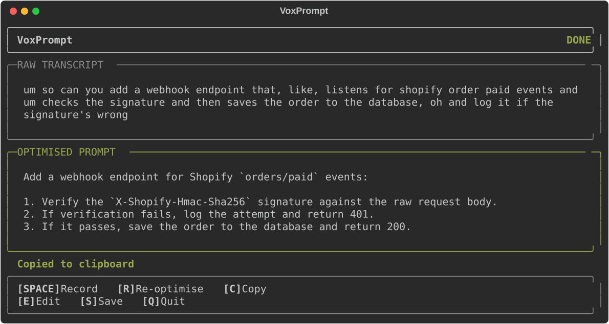
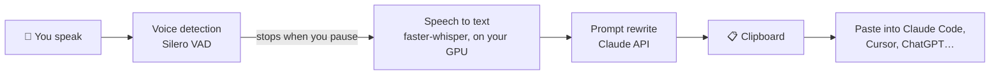

# VoxPrompt

**Talk to your AI coding assistant instead of typing to it.**

VoxPrompt listens to you speak, turns your speech into text on your own computer, asks Claude to tidy that text into a clear, well-structured prompt, and copies the result to your clipboard. You paste it straight into Claude Code, Cursor or any other AI tool.



*The terminal interface, rendered from the app's own UI code with a sample request.*

---

## Why I built it

When I work with AI coding tools I think faster than I type, so I explain things out loud. Spoken requests are messy, though: "um", false starts, half-finished sentences, and missing details the AI then has to guess. VoxPrompt keeps the speed of talking and removes the mess, so the AI gets a precise instruction first time.

It's useful for anyone who prompts AI tools all day: developers, people who find long typing tiring, or anyone who explains things better out loud.

## How it works



1. **Recording starts** when you press Space, and **stops by itself** when you pause for 1.5 seconds.
2. **Transcription happens locally.** Your audio never leaves your machine; only the text is sent on.
3. **Claude rewrites the text.** It removes filler words, adds structure and fills in obvious missing details, without changing what you asked for.
4. **The result is copied** to your clipboard, ready to paste.

## Built with

| Part | Tool |
|---|---|
| Language | Python 3.11+ |
| Speech detection | [Silero VAD](https://github.com/snakers4/silero-vad) |
| Speech to text | [faster-whisper](https://github.com/SYSTRAN/faster-whisper) (runs on an NVIDIA GPU, or more slowly on CPU) |
| Prompt rewriting | [Anthropic Claude API](https://docs.claude.com) (streamed, so you see the text appear live) |
| Terminal interface | [Rich](https://github.com/Textualize/rich) |
| Keyboard shortcuts | [pynput](https://github.com/moses-palmer/pynput) (works with macro keypads) |

---

## Quick start (Windows)

You'll need about 10 minutes and roughly 3 GB of free disk space.

### Before you start

| You need | How to check | If you don't have it |
|---|---|---|
| **Python 3.11 or newer** | Open PowerShell and run `python --version`. You should see `Python 3.11` or higher | Install from [python.org](https://www.python.org/downloads/) and tick **"Add python.exe to PATH"** during setup |
| **ffmpeg** | Run `ffmpeg -version`. You should see version details | Run `winget install --id Gyan.FFmpeg -e`, then open a new PowerShell window |
| **An Anthropic API key** | Starts with `sk-ant-` | Create one at [console.anthropic.com](https://console.anthropic.com) → **API Keys** → **Create Key** |
| **A microphone** | | |
| **An NVIDIA graphics card** *(optional)* | | Without one, VoxPrompt still works but transcription takes a few seconds longer |

### 1. Download the code

```powershell
git clone https://github.com/nomaan02/voxprompt.git
cd voxprompt
```

**You should see:** a new `voxprompt` folder, and your PowerShell prompt now ends in `\voxprompt>`.

### 2. Install everything

```powershell
.\setup.bat
```

**You should see:** `=== Setup complete ===` after a few minutes. The PyTorch download is large, so this is the slow step.

### 3. Add your API key

```powershell
copy .env.example .env
notepad .env
```

In Notepad, replace `sk-ant-your-key-here` with your real key, then save and close.

**Keep your key private.** The `.env` file is deliberately ignored by Git, so it won't be uploaded if you push changes.

### 4. Run it

```powershell
.venv\Scripts\activate
python -m voxprompt.main
```

**You should see:** the VoxPrompt screen with the status `LOADING`. The first time you run it, it downloads the speech model (about 1.5 GB), so give it a minute. When the status changes to `IDLE`, you're ready.

### 5. Try it

1. Press **Space** and say something like *"write a function that checks if an email address is valid"*.
2. Stop talking. After a short pause the status goes `TRANSCRIBING` → `OPTIMISING` → `DONE`.
3. Press **C** to copy, then paste into your AI tool.

<details>
<summary><strong>Mac or Linux?</strong></summary>

```bash
git clone https://github.com/nomaan02/voxprompt.git
cd voxprompt
chmod +x setup.sh && ./setup.sh
cp .env.example .env        # then edit .env and add your key
source .venv/bin/activate
python -m voxprompt.main
```

On a Mac there's no NVIDIA GPU, so VoxPrompt runs on the CPU automatically. Setting `VOXPROMPT_WHISPER_MODEL=small.en` in `.env` makes it faster.
</details>

---

## Keyboard shortcuts

| Key | What it does |
|---|---|
| `Space` | Start or stop recording |
| `R` | Rewrite the same request a different way |
| `C` | Copy the rewritten prompt |
| `E` | Edit the transcript by hand, then rewrite it |
| `S` | Save this session (what you said + the result) to the `sessions` folder |
| `Q` | Quit |

**Using a macro keypad?** All shortcuts live in one place, `voxprompt/config.py`. Change `"space"` to `"f13"` (and so on) to map them to the extra keys on a stream deck or macro pad.

## Settings

Everything is optional apart from the API key. Add these to your `.env` file:

| Setting | Default | What it changes |
|---|---|---|
| `ANTHROPIC_API_KEY` | *(required)* | Your Anthropic key |
| `VOXPROMPT_CLAUDE_MODEL` | `claude-sonnet-5-5` | Which Claude model rewrites your prompt |
| `VOXPROMPT_WHISPER_MODEL` | `medium.en` | Speech model size. `small.en` is faster, `large-v3` is more accurate |

Fine-tuning options (silence timeout, maximum recording length, the rewriting instructions) are in `voxprompt/config.py`.

## Troubleshooting

| Problem | Fix |
|---|---|
| `ANTHROPIC_API_KEY not set` | Check that `.env` exists in the `voxprompt` folder (not `.env.txt`) and contains your key |
| `CUDA not available — falling back to CPU` | Not an error. You don't have a supported NVIDIA GPU, so it uses the CPU instead |
| `running scripts is disabled on this system` when activating | Run `Set-ExecutionPolicy -Scope CurrentUser RemoteSigned`, answer `Y`, then try again |
| Nothing happens when I press Space | Click on the PowerShell window first so it has focus |
| `ffmpeg not found` | Install ffmpeg (see **Before you start**) and open a **new** PowerShell window |

## Project structure

```
voxprompt/
├── main.py          # Starts the app and handles key presses
├── audio.py         # Microphone recording + voice detection
├── transcriber.py   # Speech to text (faster-whisper)
├── optimiser.py     # Sends text to Claude and streams the reply
├── clipboard.py     # Copies the result
├── config.py        # All settings and shortcuts in one place
└── ui.py            # The terminal interface
```

---

## How I used AI to build this

VoxPrompt went from first commit to working v1 in a single day (13 March 2026).

- **I designed it:** the pipeline (local transcription first, so audio never leaves the machine), the keyboard-driven workflow, and the rules in the rewriting prompt. The most important rule is *never change what the user asked for*.
- **An AI coding assistant wrote the code** from that design, one module at a time, and I tested each stage on my own machine: microphone capture, GPU fallback, streaming output and macro-key mapping.
- **The rewriting prompt** (`OPTIMISER_SYSTEM_PROMPT` in `config.py`) is the heart of the tool. It's written as explicit rules (keep intent, strip spoken filler, add structure only when the request is complex), so its behaviour is predictable and easy to adjust.

## Licence

[MIT](LICENSE). Free to use, change and share.
